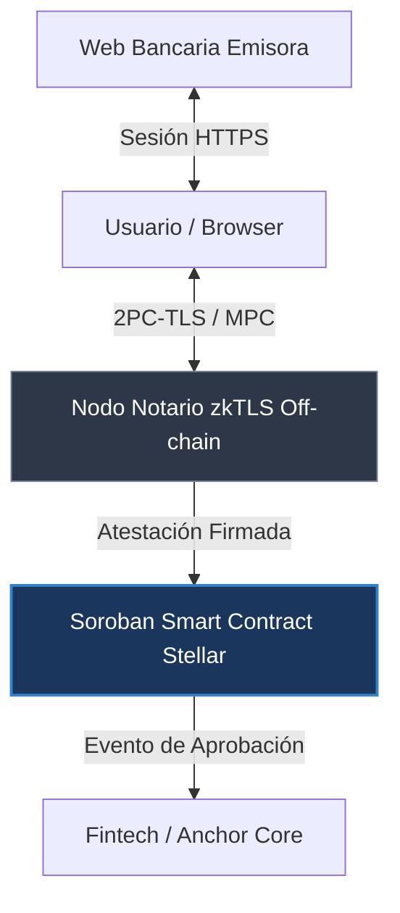

# Product Blueprint

**Nombre del proyecto:** Glemo

**Repositorio (enlace obligatorio):** [Nombre del repositorio](https://github.com/DavidZapataOh/glemo-stellar)

> Los campos marcados como *enlace obligatorio* deben ir como enlace en Markdown, con este formato: `[texto del enlace](https://...)`. Reemplacen el texto y la dirección de ejemplo.

---

## Contenido

1. Priorización de historias
2. Propuesta de valor
3. Flujo de usuario
4. Alcance del MVP
5. Lean Canvas
6. Backlog priorizado (Kanban)
7. Arquitectura inicial
8. Uso de Stellar y justificación

---

## 1. Priorización de historias

> Historias elegidas entre las que propuso el equipo y criterio con que se priorizaron. Son las que pasan al backlog. Extensión: breve.

**Criterio de priorización:** Escriban aquí el criterio (por ejemplo, imprescindible / debería / podría / queda fuera).

| Prioridad | Historia | Propuesta por | Por qué entra al backlog |
| :---: | --- | :---: | --- |
| 1 | Como oficial de riesgo de una fintech, quiero verificar matemáticamente la autenticidad del saldo e ingresos de un solicitante directamente desde su sesión bancaria web, para aprobar solicitudes al instante sin temor a documentos falsificados con IA ni demoras por revisión manual. | David | Resuelve el problema central del proyecto. Elimina el riesgo de fraude documental por IA y valida la viabilidad técnica de la extracción zkTLS. |
| 2 | Como solicitante de un crédito o servicio financiero, quiero demostrar que cumplo con un requisito económico sin exponer mi extracto bancario completo ni mi historial de transacciones, para proteger mi privacidad financiera y evitar filtraciones de datos sensibles. | David | Aporta el factor diferenciador del producto mediante pruebas de conocimiento cero (ZK), garantizando que no se extraigan ni almacenen datos sensibles innecesarios. |
| 3 | Como desarrollador de una rampa fiat-cripto (Anchor en Stellar), quiero integrar un SDK de verificación que valide atestaciones zkTLS en smart contracts de Soroban, para automatizar el onboarding de usuarios y la vinculación de cuentas bancarias en cuestión de segundos. | David | Es el habilitador técnico dentro de Stellar, sin el contrato en Soroban que valide la atestación, no existe integración con la red. |
| 4 | Como usuario final, quiero generar la prueba criptográfica de mis datos iniciando sesión directamente en mi portal bancario en un entorno seguro y con un solo clic, para no tener que descargar archivos PDF, tomar capturas de pantalla ni lidiar con formularios burocráticos. | David | Entra al backlog para asegurar que la experiencia del usuario (UX) en el navegador sea viable y no genere abandono durante la prueba. |
| 5 | Como líder de producto en una entidad financiera, quiero definir reglas de negocio parametrizables para que se comprueben automáticamente en la prueba criptográfica sin tener que reescribir la lógica técnica subyacente. | David | Se prioriza baja en el backlog inicial, en el MVP la regla será fija (ej. saldo mínimo) y la parametrización dinámica se desarrollará en una segunda etapa. |
| 6 | Como oficial de cumplimiento, quiero consultar un registro inalterable en la red de Stellar que evidencie la validez de una atestación y la fecha en que se ejecutó, para sustentar auditorías normativas sin necesidad de almacenar pasivos de datos personales. | David | Queda fuera del alcance inicial del MVP, la trazabilidad para auditorías dependerá de que el flujo de verificación y el contrato base estén completamente probados. |

*(Agreguen o borren filas según las historias que pasen al backlog.)*

---

## 2. Propuesta de valor

> Qué resultado obtiene el usuario y por qué elegiría esta solución. En qué se diferencia de cómo resuelve hoy. Conecta con el usuario del Problem Brief. Extensión: 150–300 palabras en total.

**Usuario (del Problem Brief):** Oficiales de riesgo y cumplimiento en fintechs, entidades crediticias y rampas fiat-cripto (Anchors), junto con solicitantes que requieren validar solvencia financiera.

**Resultado que obtiene:** Validación matemática e instantánea de condiciones financieras (como ingresos periódicos o saldo promedio) en menos de 10 segundos, eliminando el intercambio de archivos manuales y protegiendo la privacidad de los datos privados del usuario.

**Por qué elegiría esta solución:** Elimina por completo las pérdidas económicas causadas por documentos falsificados o manipulados mediante herramientas de inteligencia artificial. Además, reduce los costos operativos de revisión manual en más del 80% y suprime las fricciones burocráticas que causan el abandono de usuarios en los procesos de admisión.

**En qué se diferencia de cómo lo resuelve hoy:** En la actualidad, las entidades dependen de la revisión manual de PDFs fácilmente editables, llamadas telefónicas o APIs centralizadas de Open Banking que en la mayoría de países emergentes no existen, son inestables o resultan sumamente costosas. Glemo no requiere acuerdos comerciales ni el desarrollo de APIs por parte de los bancos emisores, Glemo permite que el solicitante demuestre la autenticidad de la información directamente desde su sesión web autenticada mediante zkTLS, asentando una atestación criptográfica auditable en la red de Stellar sin exponer transacciones sensibles ni credenciales de acceso.

---

## 3. Flujo de usuario

> Recorrido de la persona por la solución de principio a fin, roles y puntos de interacción. Diagrama o secuencia numerada. Extensión: 150–300 palabras.

| Paso | Rol | Qué hace | Punto de interacción |
| :---: | :---: | --- | --- |
| 1 | Solicitante | Inicia el proceso de solicitud, selecciona su entidad bancaria y autoriza la comprobación de la regla financiera solicitada. | Interfaz web de la fintech (SDK embebido de Glemo). |
| 2 | Solicitante | Inicia sesión de forma segura en el portal web de su banco, el cliente zkTLS ejecuta la sesión TLS multipartita sin capturar contraseñas. | Ventana modal o extensión segura del cliente zkTLS. |
| 3 | Red Notaria | Actúa como contraparte notarizadora en la sesión TLS, co-firmando que los datos provienen del servidor oficial del banco sin ver el contenido sensible. | Nodo notario zkTLS (Capa off-chain). |
| 4 | Solicitante | Genera la prueba de conocimiento cero sobre el campo requerido (ejemplo: saldo > $2,000 USD) y despacha la atestación firmada a la red. | Cliente local del usuario / Transacción hacia Stellar. |
| 5 | Contrato Inteligente | Recibe la transacción, verifica criptográficamente la firma del notario y la validez de la regla, emitiendo un estado inmutable de aprobación. | Smart Contract en Soroban (Red de Stellar). |
| 6 | Oficial de Riesgo | Consulta el resultado verificado en tiempo real y procede al desembolso o activación del servicio de forma inmediata. | Dashboard de la fintech / API de consulta de eventos. |

*(Agreguen los pasos que hagan falta. Si prefieren, inserten aquí un diagrama.)*

---

## 4. Alcance del MVP

> Funcionalidad central separada de la deseable que queda fuera. Justificación de por qué el recorte sigue entregando valor. Extensión: 150–300 palabras en total.

| Dentro del MVP (funcionalidad central) | Fuera del MVP (deseable, para después) |
| --- | --- |
| Extracción y atestación zkTLS para una entidad bancaria de referencia basada en web (ej. validar saldo > umbral en sesión autenticada). | Parseo directo de flujos binarios pesados de archivos PDF comprimidos dentro del cliente. |
| Generación de atestación criptográfica firmada off-chain mediante arquitectura de notarización TLS. | Descentralización completa de la red de notarios mediante comités MPC dinámicos o EigenLayer AVS. |
| Smart contract en Soroban (Rust) que valida la atestación criptográfica y registra el cumplimiento de la condición de negocio. | Verificador algebraico SNARK completo ejecutado puramente en WASM dentro de Soroban. |
| SDK de cliente en TypeScript para conectar el flujo de verificación web con el contrato en Soroban. | Panel no-code para que entidades financieras creen reglas de verificación complejas sin código. |

**Por qué el recorte sigue entregando valor:** Este recorte prioriza la validación de la hipótesis técnica más crítica: comprobar que es factible extraer datos de una sesión bancaria real mediante zkTLS, asegurar la privacidad mediante pruebas criptográficas y verificar el resultado en Soroban en pocos segundos. Al enfocarse en un único banco y una regla financiera simple (saldo mínimo), se entrega una solución funcional de punta a punta que demuestra la erradicación del fraude por IA y la velocidad de liquidación en Stellar, sin dispersar el esfuerzo en la complejidad de soportar múltiples interfaces bancarias o interfaces no-code secundarias.

---

## 5. Lean Canvas

> Lienzo de una página con el modelo del producto. Extensión: enlace (obligatorio).

**Enlace al Lean Canvas (obligatorio):** [Lean Canvas del proyecto](https://escriban-aqui-el-enlace)

El lienzo debe cubrir: problema, segmento de usuarios, propuesta de valor única, solución, canales, métricas clave, ventaja diferencial y estructura de costos e ingresos.

---

## 6. Backlog priorizado (Kanban)

> Enlace al tablero en GitHub Projects, construido con las historias priorizadas, en columnas y con criterios de aceptación por tarjeta. Extensión: enlace al tablero (obligatorio).

**Enlace al tablero (obligatorio):** [Tablero Kanban en GitHub Projects](https://github.com/users/DavidZapataOh/projects/1)

---

## 7. Arquitectura inicial

> Cómo se conectan las partes (interfaz, lógica, Stellar) y en qué punto entra la red. Diagrama simple en imagen. Extensión: 150–300 palabras en total.

| Capa | Componente | Qué hace |
| :---: | --- | --- |
| Interfaz | SDK de Cliente Web (TypeScript) | Guía al usuario en la autenticación bancaria y orquesta la conexión zkTLS en el navegador. |
| Lógica | Cliente zkTLS + Servidor Notario | Ejecutan el protocolo de TLS multipartita para autenticar la respuesta del banco y generar la atestación firmada con preservación de privacidad. |
| Stellar | Smart Contract en Soroban (Rust) | Valida la firma criptográfica de la atestación, comprueba las reglas de negocio y almacena el estado inmutable del resultado. |

**En qué punto entra la red:** La red de Stellar entra en juego una vez finalizada la sesión zkTLS off-chain. El cliente o el backend de la fintech envía una transacción invocando el smart contract en Soroban, adjuntando la atestación criptográfica firmada y los parámetros públicos de la regla. Soroban valida la firma en milisegundos y emite un evento público que desbloquea el flujo financiero de manera atómica.

---

## 8. Uso de Stellar y justificación

> Qué componentes de Stellar usaría y por qué cada uno. Apoyado en el criterio de pertinencia del Problem Brief. Extensión: 150–300 palabras en total.

**Criterio de pertinencia (del Problem Brief):** Varias partes que no confían entre sí necesitan compartir un mismo registro inalterable para validar solvencia sin depender de un intermediario centralizado que concentre la confianza.

| Componente de Stellar | Para qué lo usamos | Por qué ese y no otra alternativa |
| --- | --- | --- |
| Soroban Smart Contracts (Rust / WASM) | Alojar el contrato verificador que valida la firma criptográfica de la atestación zkTLS y aplica las condiciones de negocio requeridas. | Ofrece ejecución determinística en WebAssembly con funciones nativas de host (`crypto().ed25519_verify`) que permiten validar atestaciones en microsegundos y con costos ínfimos de CPU. |
| Red de Consenso y Libro Mayor de Stellar | Asentar el registro inmutable de la atestación y orquestar pagos condicionales inmediatos tras la verificación. | Garantiza finalidad de bloque en 3 a 5 segundos con comisiones insignificantes (fracciones de centavo), permitiendo que la validación y el desembolso ocurran en la misma interacción sin fricción. |
| Ecosistema de Anchors y estándares SEP | Proveer la capa de verificación de identidad y solvencia a las pasarelas fiat-to-crypto ya existentes en la red. | Stellar es la red líder en infraestructura de rampas de pago y remesas; anclarnos a su ecosistema nos da acceso directo al mercado de fintechs que sufren diariamente por cuellos de botella en compliance. |